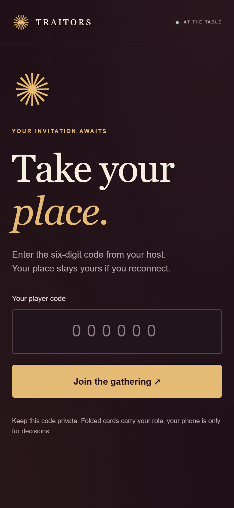
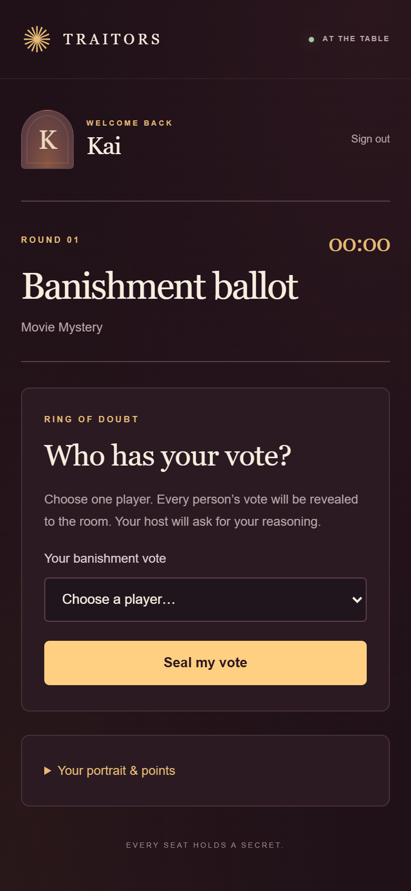

# Traitors

A self-hosted LAN party game for **10–14 players plus a separate host**. Offline mini-games, public scores, private decisions, and a projector controlled by the host. No internet connection is needed during play, and no slide editor or online mini-games are required.

## Screenshots


[Host round desk](docs/screenshots/desktop-host.png) · [Public projector](docs/screenshots/desktop-projector.png)

 

The screenshots use fictional rehearsal players. Players join and vote in their phone’s browser. [See the complete game walkthrough](docs/SCREENSHOTS.md), from the join QR and mini-games through the final reveal and backup.

**Implementation:** all four software phases are built. Automated rules/HTTP tests, a 14-player rehearsal, a real process restart, and import into a fresh database have passed. **A second physical computer, real phones, your Wi-Fi/firewall and your actual projector still need the device rehearsal in [docs/REHEARSAL.md](docs/REHEARSAL.md).** A second database on this laptop does not prove recovery from laptop hardware failure.

## Start locally

Install **Node.js 24 LTS** (the built-in SQLite API is required). No `npm install`, build step, external service, or additional runtime package is needed. The QR encoder is vendored with its MIT license.

From the project directory in PowerShell:

```powershell
node server.js
```

Alternatively:

```powershell
./scripts/start.ps1 -Port 3000 -DataDirectory './data'
```

The terminal prints:

- Local: `http://localhost:3000`
- Host: `http://localhost:3000/host`
- Projector: `http://localhost:3000/projector`
- LAN join: your laptop’s Wi-Fi address, such as `http://192.168.1.42:3000/join`
- **First-run host password. Save it privately.** It is generated once and stored as a salted scrypt hash; restarting preserves it. The `HOST_PASSWORD` environment variable sets a password on a new database only (12–256 characters recommended; at least 12 required).

Open `/host` on the host’s private screen and `/projector` on the extended projector display. Use **extend displays**, not mirror. Register the players in **Players & roles**, give each their six-digit code privately, and show the common join QR. All phones use `/join`. Optional portrait uploads are resized on the phone, with initials as fallback.

Start the gathering. If no roles were manually assigned, the server chooses the configured number of Traitors using the game’s saved random seed. Inspect the private roster and distribute folded role cards to **everyone** before opening private decisions; tell the Traitors who one another are. No phone ever shows a role, including its own.

The host desk guides each phase; nothing is revealed by an automatic timer. The timer is a room aid, not a forced transition. **Add 14 rehearsal profiles** is for an empty test lobby. Export a backup, then use **start a fresh game** in the round desk when ready to clear a rehearsal roster. A running game must be paused before this action; history remains in the local audit.

## Join over Wi-Fi

1. Connect the laptop, host device and every phone to the same trusted Wi-Fi/LAN. Avoid guest Wi-Fi with client/AP isolation enabled; it prevents devices from reaching the laptop. Internet access can be unavailable once Node is installed and the project is copied.
2. Keep the laptop on AC power, disable sleep for the party, and disconnect VPNs that interfere with LAN traffic. Prefer a DHCP reservation so the laptop address stays stable.
3. Allow Node.js through Windows Firewall on the **Private** network profile. The server listens on `0.0.0.0:3000`. Do not configure router port forwarding or expose it to the internet. If the port changes, use the new port everywhere.
4. Test the printed **LAN join** address from one actual phone. `localhost` on a phone refers to that phone, not the host laptop. If multiple adapters/VPNs are present, set the exact URL explicitly before starting:

```powershell
$env:JOIN_URL = 'http://192.168.1.42:3000/join' # replace with the laptop's actual address
node server.js
```

The QR is generated locally and contains only this common URL. It never contains a player’s code. Default address detection prefers a private IPv4 LAN address, but the host must verify the QR from an actual phone.

5. If blocked, check `ipconfig`, the Wi-Fi address, firewall permissions, guest isolation and the port. For a managed network, ask its administrator to allow inbound TCP 3000 from the party LAN. Setting `BIND_ADDRESS=127.0.0.1` intentionally makes a server local-only.

For LAN diagnostics, the scoped firewall helper and rollback instructions, see [docs/NETWORK-TROUBLESHOOTING.md](docs/NETWORK-TROUBLESHOOTING.md). VPN local-device isolation can also block access even when Windows has an allow rule.

LAN HTTP is unencrypted: use a trusted party network. Browser `getUserMedia()` camera access can be restricted on HTTP LAN origins. This app uses normal **photo file upload**, which works without camera API permission; a phone’s file chooser may offer camera capture. Use a trusted HTTPS reverse proxy/certificate if required by your network, and set `COOKIE_SECURE=1` only when serving through HTTPS. No self-signed warning bypass is needed for the default upload workflow.

## Rules and operation

Read [docs/RULES.md](docs/RULES.md) before the party. Default decisions are explicit: **one public Shield**, unranked murder penalty **6**, seeded aggregate ties for any Traitor count, one restricted banishment revote then a recorded host tie-break, and paper Shield gifts through the host. Shield count/visibility, initial Traitors and Finale threshold are configurable. These are implementation defaults proposed in response to the brief’s open questions; they can be changed before your party.

- Mini-games and group sizes are free-form. Scores can be edited live or entered as final totals later. **Set** replaces round totals; quick/bulk awards add once. Overall totals are calculated. Murdered Innocents keep playing for points.
- Normal Recruitment is once per game following a Traitor banishment with a survivor, outside the Finale. Administrative replacement for a departed Traitor is a separate audited operation and does not consume it.
- Phone disconnection never eliminates anyone. **Review player** can note a temporary disconnect, start a departure/retirement review, or restore status. The game pauses for review. Retain submitted decisions or restart an open, unrevealed ballot; review roles/Shields, then resume.
- To replace a departed Traitor, resolve departure first and keep the game paused. In **Review player** on that departed Traitor, choose an active Innocent as the administrative replacement. Reset/finish an open ballot first if it has submissions.
- Host role edits require confirmation, a reason, and a paused game after the lobby. Shields can be corrected before predictions or, with a reason, while paused before the round’s murder announcement. Past finished rounds do not silently change.
- The last reversible action can be corrected in **Recovery & audit**. Undo appends an event and invalidates phone sessions. It cannot unpublish votes, role reveals, murders or final results. Restoring an older snapshot is an explicit host recovery action; it cannot make players forget a public reveal.

## Presentations

In **Presentation**, upload PNG/JPEG/WebP files or a PDF exported from PowerPoint. Use next/previous file, PDF page number, show/hide, a hidden answer field, and reveal answer. Open the projector and use its fullscreen button (or the browser’s fullscreen command).

All uploaded slide files and every PDF page are public, even when a different file is displayed. Keep secret answers out of source PDFs; put them in the host’s hidden answer field instead. Changing file/page hides the answer overlay; enter the next clue’s answer before revealing it. Vote reveals and elimination announcements take display priority. A locally bundled PDF.js canvas viewer renders PDF pages without a browser PDF plugin. Rehearse your actual files and keep a separate PPT/PDF window as fallback. Image slides also work offline.

Files: 3 MB per photo, 15 MB per presentation file, 32 MB total stored media. Replaced/old media are retained locally for audit/undo and count toward that limit; use compressed assets and a fresh `DATA_DIR` for a new party when appropriate.

## Backup and hardware failure recovery

Download a restore snapshot from **Recovery & audit** after setup and after every round. It contains current game state, identities and codes, scores, ballots, portraits, presentation files and full audit metadata, with a SHA-256 corruption checksum. Password hashes and sessions are excluded. It is **private**, not encrypted; store it securely. The checksum detects accidental corruption, not malicious editing by a person who can rewrite the file.

**Copy the snapshot off this laptop** to a USB drive, second device or private network share. A backup only under `data/` or Downloads on the same laptop does not cover hardware loss. Export can also go directly to an attached backup destination:

```powershell
node scripts/backup.js --data './data' --out 'E:\TraitorsBackup\party.backup.json'
# Or a private network share:
node scripts/backup.js --data './data' --out '\\SECOND-LAPTOP\PartyBackup\party.backup.json'
```

Use your actual drive/share. The exporter reads a consistent SQLite transaction and writes a temporary file then renames it; the server may keep running. Verify the file really exists on the second device. Do not copy only `party.sqlite` while it is running: committed data may still be in its WAL file.

On a **second physical computer**:

1. Install Node.js 24, copy this application folder (no `data/` needed), and attach/open the off-device snapshot.
2. Run `node server.js`. Save the newly generated host password and open `/host`.
3. In **Recovery & audit**, select the snapshot, enter a reason, confirm replacement, and restore. Invalid checksums or malformed state are rejected before writing. Destination audit history is retained; source history is archived inside the restore event.
4. Review the restored game, which starts **paused**. Check roles, status, points, current ballot and media. Previously logged-in phones must rejoin; codes map to the same permanent IDs and never revive eliminated players.
5. Update `JOIN_URL` to the second computer’s LAN address if needed. Share that new common URL/QR, rejoin the phones, then resume. Pause freezes the timer; the import preserves its remaining time at export.

For a normal restart on the same computer, run the same start command with the same `DATA_DIR`. State, current reveal position, votes and valid sessions survive; a running timer uses its saved absolute deadline. An actual abrupt process termination/restart has been rehearsed. Source undo checkpoints remain local to the database; portable backups preserve current state and full audit metadata, rather than all historical undo images.

Run only one game server per `DATA_DIR`. Separate test/production directories are supported. Keep all `data/`, backups and `test-output/` private and out of source control.

If you forget the host password and have local filesystem access, stop the server and run:

```powershell
$env:NEW_HOST_PASSWORD = 'choose-a-new-private-password'
node scripts/reset-password.js
Remove-Item Env:NEW_HOST_PASSWORD
node server.js
```

This audits the recovery and revokes host sessions. Set `DATA_DIR` first if using a non-default folder. Avoid putting a real password in shared shell history.

## Verification and project layout

```powershell
node scripts/check.js
node --test --test-concurrency=1 tests/*.test.js
node scripts/rehearsal.js
```

The rehearsal launches two real server processes with isolated source/destination directories, simulates 14 player sessions, terminates/restarts a process, transfers a snapshot, restores into a fresh database, then finishes the Finale. It writes a report and private fixtures/backups to `test-output/rehearsal/<timestamp>/`. It does not claim those two processes are two physical computers. See [docs/VERIFICATION.md](docs/VERIFICATION.md) for results and [docs/REHEARSAL.md](docs/REHEARSAL.md) for the remaining physical-device sign-off.

`server.js` owns HTTP/authentication and media; `lib/game.js` owns rules and allowlisted public/phone views; `lib/store.js` owns SQLite transactions, audit and sessions; `lib/backup.js` validates portable snapshots; `public/` holds the three browser interfaces. [docs/SPEC.md](docs/SPEC.md) describes the game requirements. [docs/IMPLEMENTATION.md](docs/IMPLEMENTATION.md) records the architecture and implementation phases. [THIRD_PARTY.md](THIRD_PARTY.md) records licensing.
