# Traitors: a game in screenshots

Follow a three-round demo with 14 fictional players. The screenshots show the host's private controls, the public projector and the player experience in a mobile browser. The lobby QR uses an example address.

## 1. Gather the players

Open the [desktop home page](screenshots/desktop-home.png) to reach the host, projector and player views. The projector shows one join QR for the room. Players enter their own six-digit code on their phones.

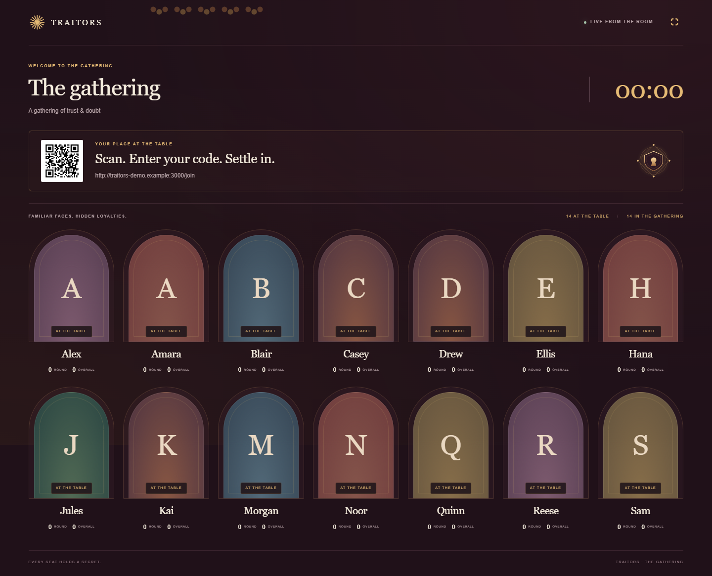

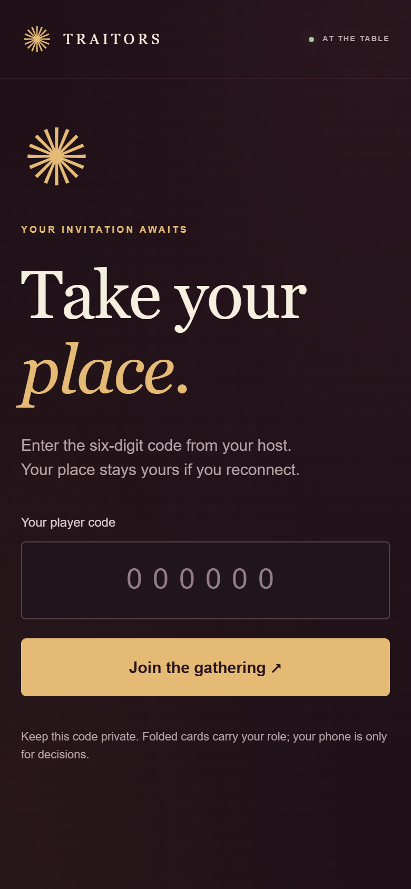

## 2. Run a mini-game and award a Shield

The host can set points or award them to individuals and teams. Players see both the current round and overall standings on the projector.

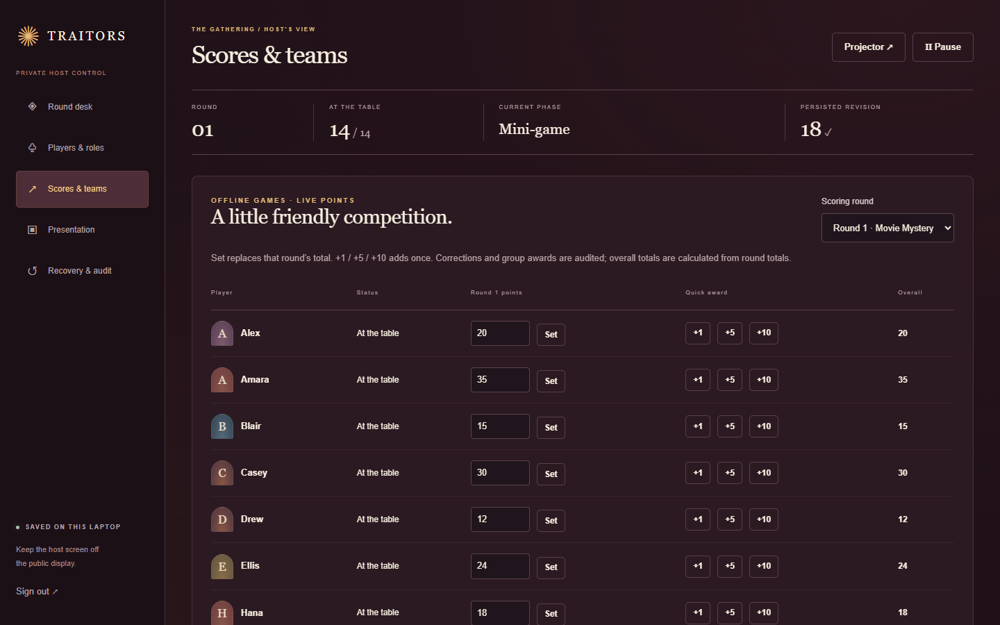

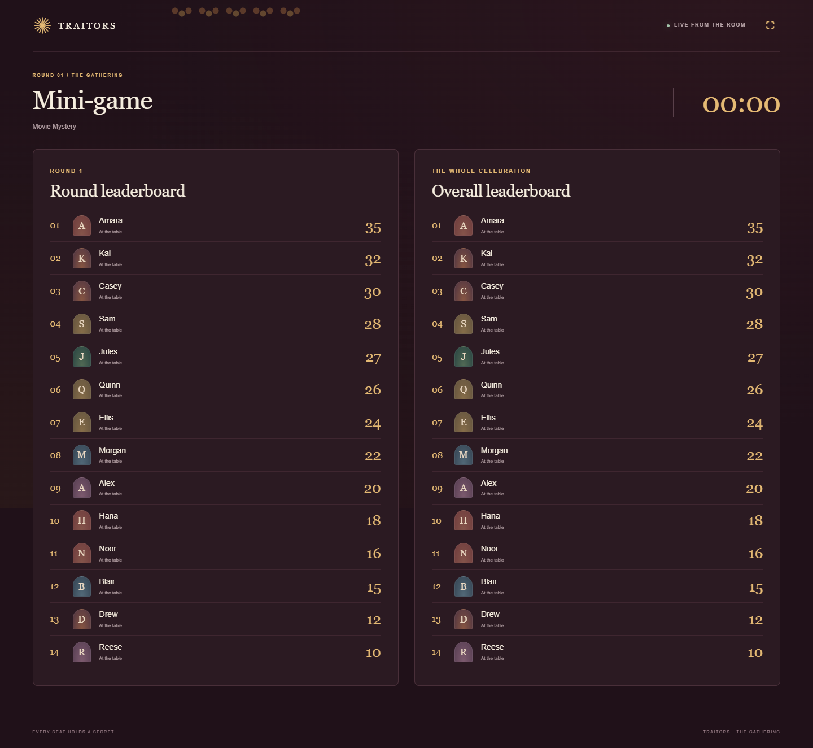

For this demo, the host [loads a PDF clue](screenshots/host-presentation.png) for a movie guessing game. The answer stays on the host screen until it is revealed.

The host awards the highest eligible scorer a Shield for the round.

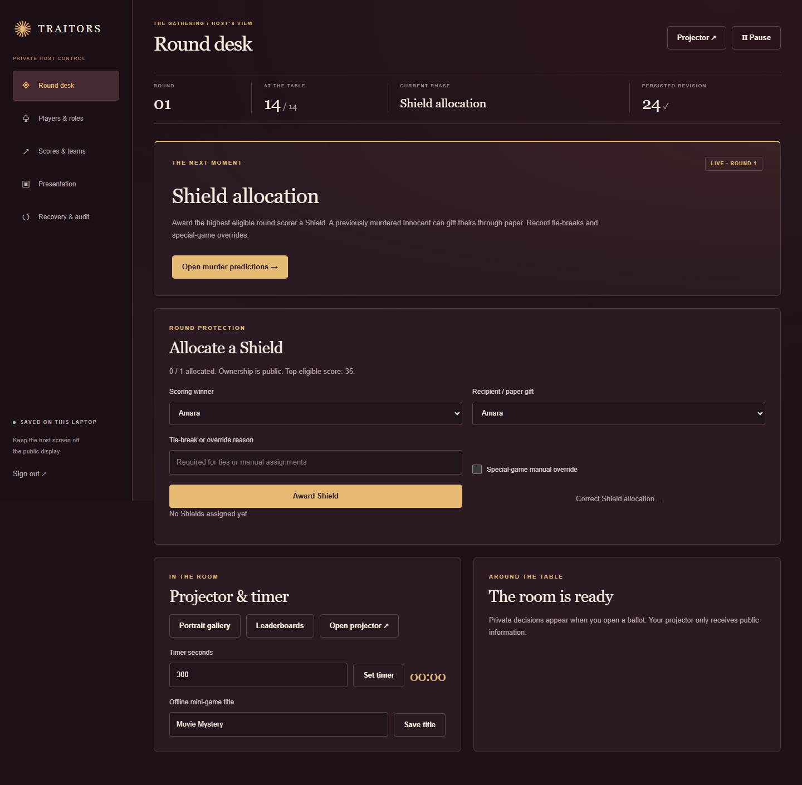

## 3. Predict, discuss and vote

Every active player gets the same prediction ballot. After the predictions close, the host leads the Ring of Doubt discussion in the room. Players then submit a banishment vote and see confirmation that it is locked.

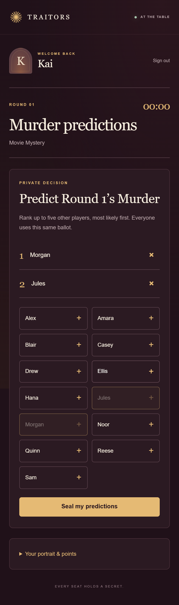 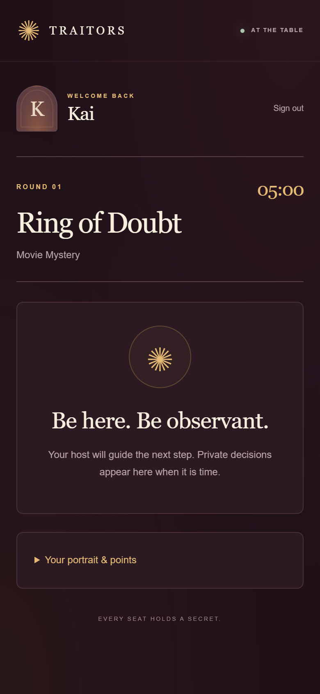

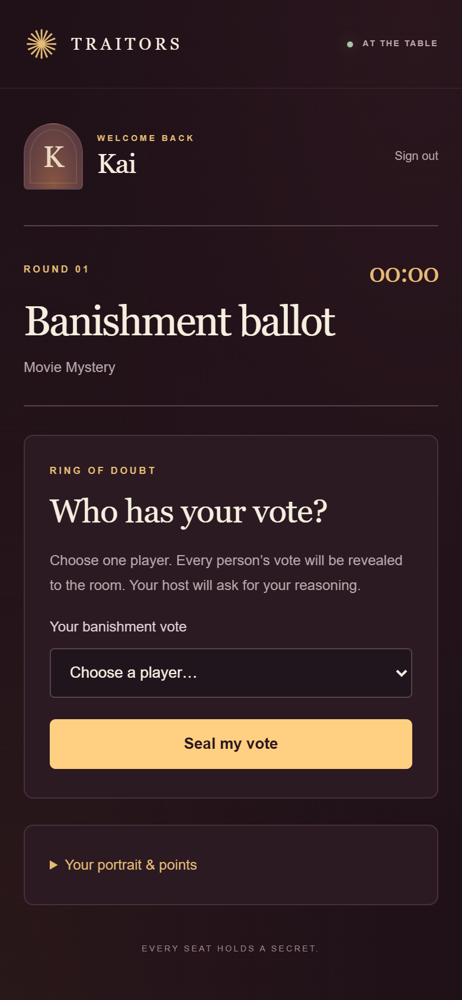 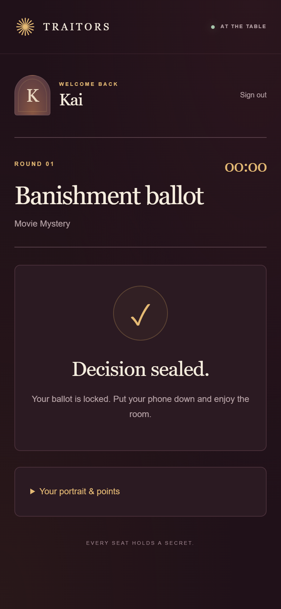

The [host round desk](screenshots/desktop-host.png) shows which players have submitted. The [public portrait gallery](screenshots/desktop-projector.png) shows players, points and any public Shields. When the ballot closes, the host reveals each vote one at a time and asks the voter for their reasoning.

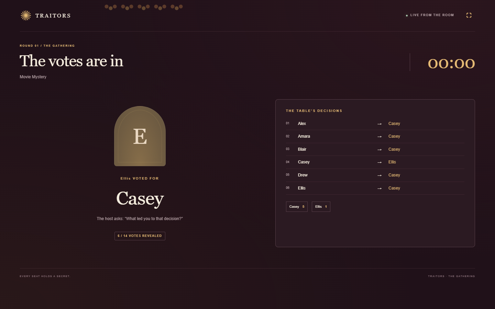

## 4. Reveal the round's outcome

The projector reveals the banished player's role, then announces the murder. Murdered players can still compete in offline mini-games for points, and their phone stops offering ballots.

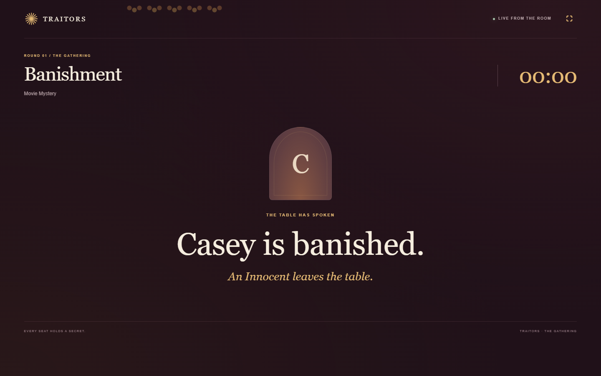 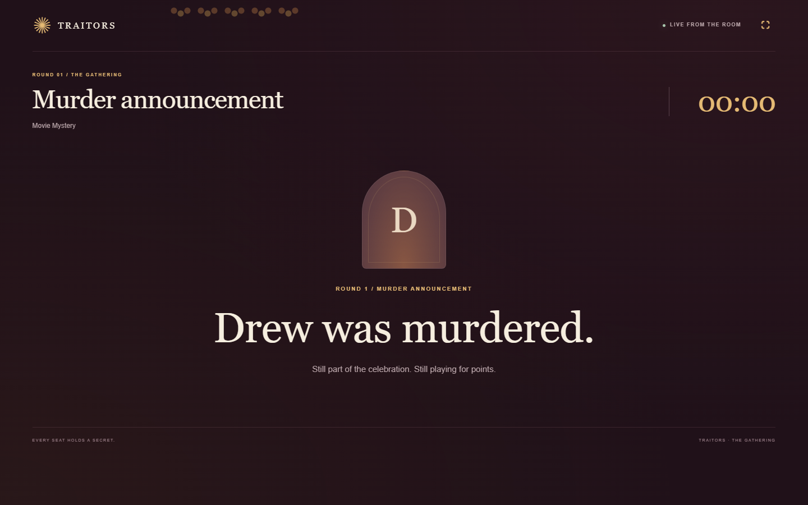

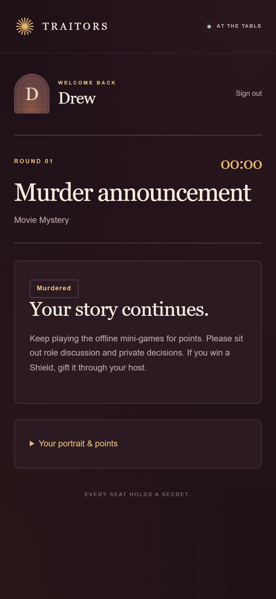

In a later round, a surviving Traitor can recruit after a Traitor is banished. The [private recruitment controls](screenshots/host-recruitment.png) let the host record that paper decision.

## 5. Play the Finale

The remaining players choose TRUST or TRAITOR. A TRAITOR choice starts another banishment vote; unanimous TRUST ends the game. The final reveal names the winning faction and the offline mini-game champion separately.

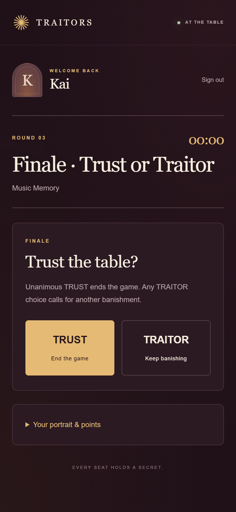

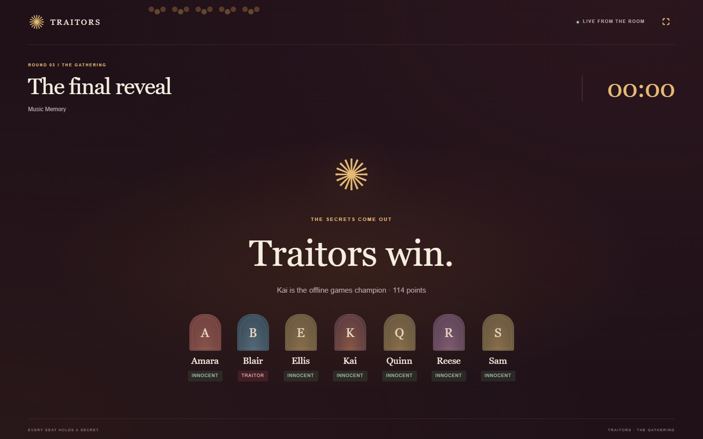

## 6. Save the game

The host can export a restore snapshot, import a backup and review the audit history. The screenshots contain no actual snapshot or player credentials.

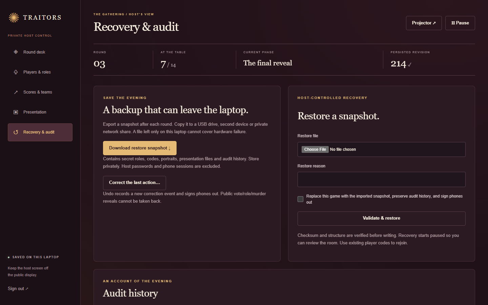
